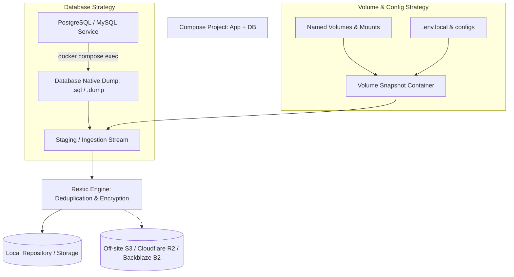

# Dockit: Architecture & Release Roadmap

This document outlines the architectural plan, backup system design, and phased release roadmap for **Dockit** (transitioned from Tug), reflecting the requirements for automatic incremental backups, safety preflights, and reliable operations.

---

## 1. Project Rename Summary

The project has been renamed from **Tug** to **Dockit**:
- **Cargo Package & Binary**: `dockit` ([`Cargo.toml`](../Cargo.toml), [`src/main.rs`](../src/main.rs)).
- **Ignore File**: Primary `.dockitignore` at repository root, with transparent fallback to legacy `.tugignore` so existing setups do not break.
- **Shell Completions**: Emits `_dockit` completion scripts for `bash`, `zsh`, and `fish` calling `dockit __complete`.
- **Install & Release Scripts**: [`install.sh`](../install.sh) installs `dockit` to `~/.local/bin/dockit` with support for `DOCKIT_VERSION` / `DOCKIT_INSTALL_DIR` (falling back to `TUG_*`). Release CI artifacts package `dockit-${TAG}-${TARGET}`.
- **Full Test Suite**: Integration tests, seams, grammar completers, and fixtures are aligned and verified.

---

## 2. Backup System Design

### 2.1 The Fundamental Distinction: Incremental Backups vs. Database Backups
- **Database Backups**: Copying live database files (e.g., PostgreSQL data directories) leads to corruption or inconsistent states. PostgreSQL and MySQL require database-aware strategies:
  - **Phase 1**: Database-native dumps (e.g., `pg_dump` via `docker compose exec`).
  - **Phase 2**: WAL archiving and base backups for Point-In-Time Recovery (PITR).
- **Volume & File Backups**: Back up named volumes, bind-mounted configuration directories, and environment definitions. Never treat a live database volume as a generic volume backup.



### 2.2 Content-Addressed Snapshots via Restic
Rather than reinventing chunking, deduplication, and retention:
- **Engine**: [Restic](https://restic.readthedocs.io/) handles snapshot storage, content-addressed deduplication, client-side encryption, and repository integrity.
- **Orchestration**: Dockit coordinates container state (quiescing/flushing where needed), triggers database dumps, mounts volumes, passes data to Restic, verifies exit codes, and manages retention locks.
- **Safety Invariant**: Old snapshots are **never** pruned until a newer snapshot completes successfully and integrity is verified.

---

## 3. Phased Release Roadmap

```mermaid
timeline
    title Dockit Roadmap
    section Release 1 : Foundation & Preflight
        dockit doctor : Environment, Docker, disk & permissions
        dockit preflight : Validate Compose, env vars, mounted files
        dockit plan : Action preview before execution
        JSON Output & Exit Codes : CI/CD machine-readable reporting
    section Release 2 : Backup & Verified Recovery
        dockit backup : Project backups (volumes + native db dumps)
        dockit backup schedule & retention : Automatic snapshots & 7d/4w/3m rules
        Restic Engine Integration : Deduplication & remote S3/R2 storage
        dockit restore : Preview with --dry-run & overwrite protection
        Restore Testing : Automated sandbox restore verification
    section Release 3 : Reliable Operations
        Guided Updates : Pre-deployment snapshot & automated apply
        Rollback Assistance : Automated rollback if health checks fail
        Health Check Recovery : Dependency-aware recovery cascades
        Pipeline Integration : Webhook & notification alerts
```

### Release 1: Safety and Preflight
*The bedrock. Solidify execution safety before managing user data.*

1. **`dockit doctor`**
   - Check Docker daemon connectivity and Docker Compose version.
   - Verify permissions (user in `docker` group, access to `.secrets/`, write permissions on repo root).
   - Check available disk space and dependencies.
2. **`dockit preflight`**
   - Validate Compose file syntax and linting.
   - Detect missing environment variables across `.env.local` / `.env`.
   - Audit mounted files, volumes, and risky configuration options (e.g. `privileged: true`, host port conflicts).
3. **`dockit plan`**
   - Preview actions before running (`up`, `down`, `pull`, `configure`), detailing dependency order and affected containers.
4. **CI/CD Readiness**
   - Machine-readable `--json` output across all commands.
   - Strict, standardized exit codes.
   - Comprehensive error reporting and diagnostics for failed commands.

---

### Release 2: Automated Backup and Recovery
*Differentiator: Backups that are not just created, but verified and restorable.*

1. **`dockit backup <project>`**
   - Project-level backup combining native DB dumps and volume/file snapshots.
   - Local snapshots stored in content-addressed Restic repository.
2. **`dockit backup schedule` & Retention**
   - Recurring schedules (e.g., daily cron).
   - Retention policy defaults: 7 daily, 4 weekly, 3 monthly recovery points.
   - Pruning guard: prune only after successful newer backup verification.
3. **`dockit backup list` & `dockit backup verify`**
   - List available snapshots, timestamps, and sizes.
   - Verify repository integrity (`restic check`) and checksums.
4. **`dockit restore <project> --snapshot <id>`**
   - Mandatory `--dry-run` preview showing what volumes and databases will be replaced.
   - Overwrite protection requiring explicit confirmation.
5. **Isolated Restore Testing**
   - Automated sandbox restore in isolated Docker network/volumes to verify actual restoration feasibility without interrupting production.
6. **Remote Storage & Encryption**
   - Support S3-compatible destinations (Cloudflare R2, Backblaze B2, MinIO).
   - End-to-end repository encryption.
   - Failure and success notification hooks (webhooks, email).

---

### Release 3: Reliable Operations
*Self-healing, deployment safety, and operational continuity.*

1. **Guided Compose Updates**
   - Automated pre-update backup snapshot prior to applying any image or Compose file update.
2. **Rollback Assistance**
   - Automatic or one-command rollback to pre-update snapshot if post-deployment health checks fail.
3. **Dependency-Aware Health Monitoring**
   - Health checks that understand the dependency cascade order.
   - Safe restart sequencing for cascaded dependencies.
4. **Audit & History**
   - Comprehensive history logs for deployments, provisioning changes, and backup events.
5. **Scheduled Maintenance & Retention Cleanup**
   - Automated garbage collection and unreferenced volume cleanup.
   - Webhook notifications for CI/CD pipelines and alert channels.

---

## 4. User Experience Walkthrough

```bash
# 1. Inspect Docker, system health, and disk headroom
dockit doctor

# 2. Validate Compose configuration, env vars, and port/volume settings
dockit preflight myapp

# 3. Preview execution plan
dockit plan up myapp

# 4. Trigger an incremental project backup (volumes + native db dump)
dockit backup myapp

# 5. Inspect snapshots
dockit backup list myapp

# 6. Verify repository and snapshot integrity
dockit backup verify myapp

# 7. Safe recovery preview
dockit restore myapp --snapshot latest --dry-run

# 8. Restore with explicit confirmation
dockit restore myapp --snapshot latest
```
