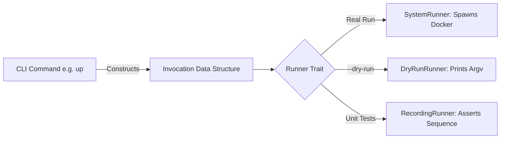

# Architecture & The Seam

At the heart of Flovo Dockit lies an architectural pattern that separates decision-making from external effects: **The Process-Spawn Seam**.

---

## 1. The Seam Pattern

Most CLI tools execute shell commands directly or call `std::process::Command::spawn` ad-hoc across various submodules. This makes them difficult to unit-test, requires a running Docker daemon during CI runs, and makes `--dry-run` a messy afterthought full of conditional checks.

In Dockit, **no business logic ever spawns a process directly**.



### The `Invocation` Object

An `Invocation` describes an external command as pure, immutable data:

```rust
pub struct Invocation {
    pub argv: Vec<String>,
    pub cwd: PathBuf,
    pub env: BTreeMap<String, String>,
    pub stdout: StdoutSink,
    pub stdin: StdinSource,
}
```

### The `Runner` Trait

```rust
pub trait Runner {
    fn run(&mut self, invocation: &Invocation) -> anyhow::Result<Outcome>;
}
```

By swapping the `Runner` implementation:
- **`SystemRunner`**: Real execution with native POSIX signal forwarding (`SIGINT`/`SIGTERM`) and child exit code propagation.
- **`DryRunRunner`**: Prints single-line commands to stdout without executing anything.
- **`RecordingRunner`**: Records the exact sequence of invocations for deterministic assertions in integration tests.

---

## 2. Dependency Graph & Topological Ordering

Dockit treats the service architecture as a Directed Acyclic Graph (DAG) derived from `implicitDependencies`.

- **Transitive Closure**: Running `dockit up app` computes the full upstream cascade of `app`.
- **Topological Order**: Services are scheduled strictly such that dependencies are provisioned and started before dependents. Ties are broken deterministically by declaration order.
- **Cycle Detection**: Cycles (e.g. `A -> B -> C -> A`) are caught before any processes are spawned, outputting the exact cycle chain to stderr and exiting non-zero.
- **Reverse Topological Order**: `dockit all down` tears down running services in reverse topological order (dependents first), preventing connection drops.
